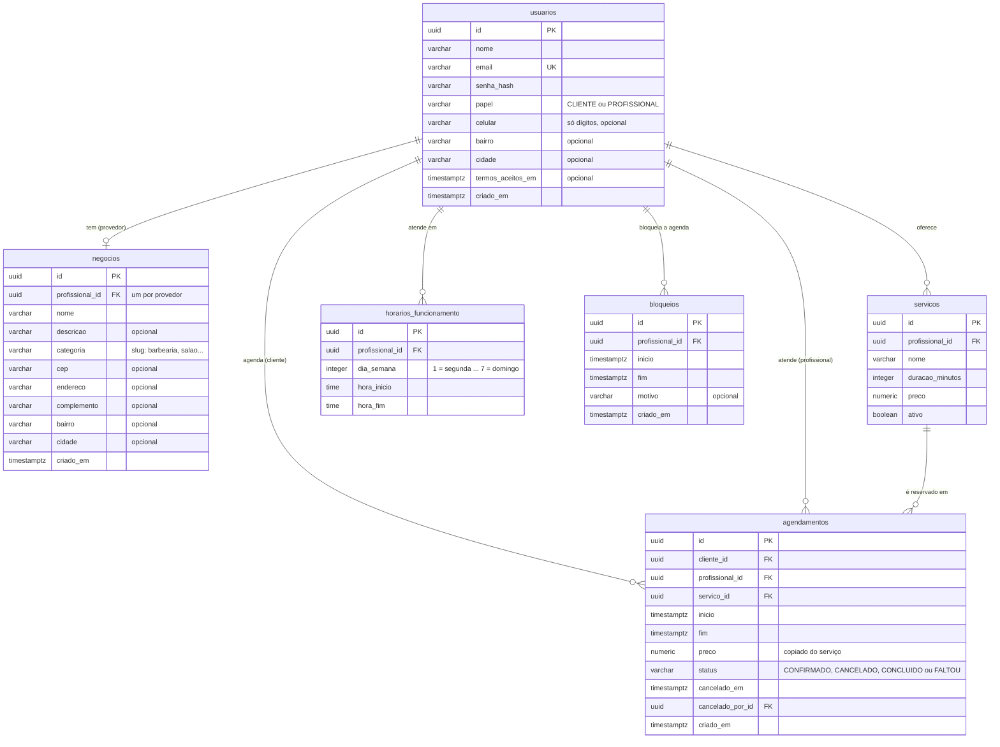

# Banco de dados do STIZY

> **Responsável:** Ian (banco de dados e persistência)  
> **Última atualização:** 23/11/2026, migrações V3 a V5

O banco é PostgreSQL 17 (container `stizy-postgres` do `docker-compose.yml`). O Flyway aplica as migrações de `backend/src/main/resources/db/migration` quando o back-end sobe, e o Hibernate só confere se as entidades batem com as tabelas (`ddl-auto: validate`).

## Migrações

| Versão | Arquivo | O que cria | Autor |
| --- | --- | --- | --- |
| V1 | `V1__criar_usuarios.sql` | `usuarios` | David |
| V2 | `V2__criar_servicos.sql` | `servicos` | David |
| V3 | `V3__criar_horarios_e_bloqueios.sql` | `horarios_funcionamento`, `bloqueios` e a extensão `btree_gist` | Ian |
| V4 | `V4__criar_agendamentos.sql` | `agendamentos` e a restrição `UNIQUE (id, profissional_id)` em `servicos` | Ian |
| V5 | `V5__criar_negocios_e_dados_do_usuario.sql` | `negocios` e as colunas `celular`, `bairro`, `cidade` e `termos_aceitos_em` em `usuarios` | Ian |

- Migração que já rodou não se edita: o Flyway compara o conteúdo e o back-end deixa de subir. Qualquer ajuste vai num arquivo novo (V6, V7...).
- Antes de criar uma migração, combinar o número com a equipe para duas branches não usarem a mesma versão. As migrações também precisam entrar na `main` em ordem: a V3 a V5 dependem da V2.
- A V3 ativa a extensão `btree_gist`, que já vem com o PostgreSQL. No container ela é ativada sem configuração extra; foi testado também com um usuário que é só dono do banco, sem ser superusuário, como costuma ser em hospedagens.

## Diagrama



## Tabelas

**`usuarios` (V1 e V5).** Cliente ou profissional, pelo campo `papel`. Um profissional também pode agendar como cliente de outro profissional (RF02). A V5 acrescenta `celular` (só dígitos, com DDD), `bairro`, `cidade` e `termos_aceitos_em` (quando a pessoa aceitou os termos de uso, RNF06). Essas colunas são opcionais no banco, para quem já tem conta continuar válido; a API decide o que é obrigatório em cada cadastro. CPF não é guardado por enquanto (LGPD).

**`negocios` (V5).** Como o cliente vê o provedor (RF01, RF05): nome, descrição, categoria e endereço. Cada provedor tem um negócio só. `categoria` é um dos slugs de `frontend/src/constants/categorias.js` (`barbearia`, `salao`, `gas-e-agua`...). Quem é freelancer, sem endereço fixo, deixa o endereço vazio. As outras tabelas continuam ligadas ao profissional: nas rotas `/negocios/:id/...`, a API pega o `profissional_id` do negócio.

**`servicos` (V2).** Serviços do profissional, com duração em minutos e preço (RF03). Serviço não é apagado, é desativado (`ativo = false`).

**`horarios_funcionamento` (V3).** Grade semanal do profissional (RF04), uma linha por faixa de atendimento. A pausa para o almoço são duas faixas no mesmo dia (ex.: terça 08:00–12:00 e 13:00–18:00). `dia_semana` vai de 1 (segunda) a 7 (domingo), o mesmo número de `java.time.DayOfWeek.getValue()`. As horas ficam na hora local do negócio.

**`bloqueios` (V3).** Horários bloqueados (RF17), folgas e férias (RF14), com início, fim e motivo opcional. Um bloqueio de dias inteiros vai da meia-noite do primeiro dia até a meia-noite do dia seguinte ao último (o fim não conta).

**`agendamentos` (V4).** Reserva de um cliente com um profissional para um serviço (RF05 a RF08). `fim` é o início mais a duração do serviço, e `preco` é copiado do serviço na hora da reserva, para que mudar o serviço depois não altere reservas já feitas.

| Status | Quando | Ocupa o horário? |
| --- | --- | --- |
| `CONFIRMADO` | ao reservar (valor padrão) | sim |
| `CANCELADO` | cliente ou profissional cancelou; preencher `cancelado_em` e `cancelado_por_id` | não |
| `CONCLUIDO` | atendimento feito; é o que conta para a frequência (RF12) e o faturamento (RF15) | sim |
| `FALTOU` | o cliente não apareceu | sim |

## O que o banco garante

| Regra | Restrição | Erro |
| --- | --- | --- |
| O mesmo profissional não tem dois agendamentos ativos que se cruzam (RF07, RNF05) | `ex_agendamentos_sem_sobreposicao` | 23P01 |
| Faixas da grade do mesmo profissional, no mesmo dia, não se cruzam | `ex_horarios_funcionamento_sem_sobreposicao` | 23P01 |
| O serviço do agendamento é do mesmo profissional do agendamento | `fk_agendamentos_servico_do_profissional` | 23503 |
| O cliente não é o próprio profissional | `chk_agendamentos_cliente_diferente` | 23514 |
| Status só pode ser `CONFIRMADO`, `CANCELADO`, `CONCLUIDO` ou `FALTOU` | `chk_agendamentos_status` | 23514 |
| Cancelado sempre tem `cancelado_em`, e só cancelado tem | `chk_agendamentos_cancelamento` | 23514 |
| Só o cliente ou o profissional do agendamento aparecem como quem cancelou | `chk_agendamentos_cancelado_por` | 23514 |
| O fim vem depois do início (agendamento, bloqueio e faixa da grade) | `chk_agendamentos_intervalo`, `chk_bloqueios_intervalo`, `chk_horarios_funcionamento_intervalo` | 23514 |
| `dia_semana` de 1 a 7 | `chk_horarios_funcionamento_dia_semana` | 23514 |
| Preço não negativo | `chk_agendamentos_preco` | 23514 |
| Um negócio por provedor | `uq_negocios_profissional` | 23505 |
| Nome do negócio não fica em branco | `chk_negocios_nome_nao_vazio` | 23514 |
| Categoria no formato de slug (`barbearia`, `gas-e-agua`) | `chk_negocios_categoria` | 23514 |
| CEP com 8 dígitos e celular com 10 ou 11, sem máscara | `chk_negocios_cep`, `chk_usuarios_celular` | 23514 (com a máscara, o texto passa do tamanho da coluna: 22001) |

Horários que só encostam podem existir juntos: 09:00–09:30 e 09:30–10:00, porque o fim não conta. Cancelar libera o horário; concluído e faltou continuam ocupando. A regra contra sobreposição vale também ao remarcar e ao reativar um agendamento.

## O que fica com a API

O banco não cruza um agendamento com a grade nem com os bloqueios. Por isso a API precisa:

- oferecer e aceitar só horários dentro da grade do profissional e fora dos bloqueios;
- deixar só quem tem papel `PROFISSIONAL` criar negócio, serviços, grade e bloqueios (o banco aceita qualquer usuário em `profissional_id`, como na V2);
- calcular `fim` (início + duração do serviço) e copiar o `preco` do serviço;
- conferir quem pode ver, cancelar e remarcar cada agendamento (RNF04);
- trocar o `negocioId` que o front manda pelo `profissional_id` do negócio;
- tirar a máscara de CEP e celular antes de gravar, e preencher `termos_aceitos_em` no cadastro;
- converter o tipo de negócio escolhido no cadastro do provedor (Barbeiro, Salão de beleza...) para uma das categorias da tela de início (`barbearia`, `salao`...), porque no front as duas listas são diferentes.

## Alinhamento com o guia do front-end

O guia `frontend/docs/INTEGRACAO.md` (branch `frontend`, do João) lista o que as telas usam. No banco fica assim:

| No guia do front | No banco |
| --- | --- |
| Negócio / Provedor | `negocios`, ligado ao provedor em `usuarios` |
| Serviço | `servicos` |
| Horário de atendimento (abre, fecha e intervalo) | `horarios_funcionamento`: com intervalo, o dia tem duas faixas |
| Bloqueio de horário (RF17) e ausência (RF14) | `bloqueios`: os dois viram uma linha com início e fim |
| Agendamento | `agendamentos` |
| `negocioId` nas requisições | a API troca pelo `profissional_id` do negócio |
| `valor` | `preco` |
| `status` em minúsculas (`confirmado`, `cancelado`, `concluido`) | em maiúsculas; `FALTOU` existe no banco, mas o front ainda não mostra |
| `DELETE /agendamentos/:id` | não apaga a linha: marca `CANCELADO`, com `cancelado_em` e `cancelado_por_id` |
| `PUT /agendamentos/:id/remarcar` | altera `inicio` e `fim` do mesmo agendamento, e o banco confere o conflito de novo |
| Restrição única em (negócio, início) | a V4 faz mais: recusa qualquer horário que se cruze, não só o mesmo início |

Fora do MVP, como decidido em 23/11 (ver Decisões): pagamento online por Pix e a forma de pagamento do agendamento (até lá a API devolve `presencial`), tipo `entrega`, produtos e pedidos, serviço "a combinar", avaliações (a nota fica vazia), chat, notificações, taxa de 8% e rascunho do cadastro. Também ficaram de fora desta versão: CPF e CNPJ, foto ou logo, e a distância de "Perto de você", que precisa de latitude e longitude.

## Datas e fuso horário

- `inicio`, `fim`, `cancelado_em`, `criado_em` e `termos_aceitos_em` são `TIMESTAMPTZ`: o PostgreSQL guarda o instante em UTC (RNF07). A API devolve em UTC, e o front-end mostra no fuso de quem está usando.
- `hora_inicio` e `hora_fim` da grade são `TIME`, na hora local do negócio (`America/Recife`, UTC−3, sem horário de verão). Para transformar uma faixa da grade num instante:
  - Java: `data.atTime(horaInicio).atZone(ZoneId.of("America/Recife")).toInstant()`
  - SQL: `(DATE '2026-11-24' + hora_inicio) AT TIME ZONE 'America/Recife'`
- `13:00Z` e `10:00-03` são o mesmo instante, e o banco trata os dois como o mesmo horário (teste 21 de `testes_banco.sql`).

## Notas para o mapeamento JPA

| Coluna | Tipo sugerido na entidade |
| --- | --- |
| `id` | `UUID` com `@GeneratedValue(strategy = GenerationType.UUID)`, como em `Usuario` e `Servico` |
| `cliente_id`, `profissional_id`, `cancelado_por_id` | `@ManyToOne Usuario` |
| `negocios.profissional_id` | `@OneToOne Usuario` |
| `servico_id` | `@ManyToOne Servico` |
| `dia_semana` | `Integer` (para converter: `DayOfWeek.of(diaSemana)`) |
| `hora_inicio`, `hora_fim` | `LocalTime` |
| `inicio`, `fim`, `cancelado_em`, `termos_aceitos_em` | `Instant` (ou `OffsetDateTime`), não `LocalDateTime` |
| `preco` | `BigDecimal` com `precision = 12, scale = 2` |
| `status` | enum `StatusAgendamento` com `@Enumerated(EnumType.STRING)`, como `Papel` |
| textos (`celular`, `cep`, `categoria`...) | `String`, com o mesmo `length` da coluna |
| `criado_em` | deixar fora da entidade, como em `Usuario`, ou mapear com `insertable = false, updatable = false`; se for mapeado de outro jeito, o Hibernate manda `null` e o banco recusa |

A chave estrangeira composta não aparece no JPA: basta preencher `profissional` e `servico`, e o banco recusa se o serviço for de outro profissional. Se a entidade `Usuario` continuar sem os campos novos da V5, o `validate` não reclama: coluna a mais no banco não atrapalha.

## Reservas simultâneas

Resultados de `teste_reservas_simultaneas.sh`, com todos os pedidos liberados no mesmo instante:

| Situação | Pedidos ao mesmo tempo | Gravados no mesmo horário |
| --- | --- | --- |
| Sem a regra no banco, só conferindo antes de gravar (controle) | 20 | 20 |
| Com a V4, cada pedido só faz o INSERT | 20 e 50 | 1 |
| Com a V4 e trava no profissional antes do INSERT | 20 e 50 | 1 |

Em todas as rodadas com a V4, só um agendamento foi gravado. A diferença está no erro devolvido aos outros pedidos: **sem trava, parte das recusas pode vir como deadlock (`40P01`) em vez de conflito (`23P01`)**. Em duas rodadas com 50 pedidos, 22 e 7 recusas vieram como deadlock. É um comportamento conhecido do PostgreSQL quando várias transações gravam o mesmo intervalo ao mesmo tempo, e não grava nada errado, mas a API precisa responder 409 nos dois casos. Com a trava, os pedidos entram em fila e todas as recusas foram `23P01`.

Sugestão para a criação de agendamentos (código não compilado aqui, só para orientar):

1. Dentro da transação da reserva, travar a linha do profissional:

   ```java
   // UsuarioRepository
   @Lock(LockModeType.PESSIMISTIC_WRITE)
   @Query("select u from Usuario u where u.id = :id")
   Optional<Usuario> buscarParaReserva(@Param("id") UUID id);
   ```

2. Conferir a disponibilidade (grade, bloqueios e agendamentos), para devolver uma mensagem clara.
3. Gravar com `agendamentoRepository.saveAndFlush(agendamento)`, para o INSERT acontecer na hora e o erro aparecer dentro do método.
4. Transformar os erros de conflito em 409:

   ```java
   @ExceptionHandler({DataIntegrityViolationException.class, PessimisticLockingFailureException.class})
   ResponseEntity<Map<String, String>> conflito(DataAccessException ex) {
       if (ex.getMostSpecificCause() instanceof SQLException sql
               && ("23P01".equals(sql.getSQLState()) || "40P01".equals(sql.getSQLState()))) {
           return ResponseEntity.status(HttpStatus.CONFLICT).body(Map.of("erro", "Horário indisponível"));
       }
       throw ex;
   }
   ```

A trava não substitui a regra do banco: se algum caminho do código esquecer de travar, a restrição continua impedindo a sobreposição. O mesmo vale para remarcar.

## Como testar

No Codespaces, na raiz do repositório:

1. Subir o banco: `docker compose up -d`
2. Subir o back-end, que aplica as migrações: `cd backend && ./mvnw spring-boot:run`. No log deve aparecer o Flyway levando o banco até a versão 5.
3. Em outro terminal, na raiz, rodar os testes das regras:

   ```bash
   docker exec -i stizy-postgres psql -U stizy -d stizy < docs/testes_banco.sql
   ```

   Esperado: `52 de 52 testes passaram`. Tudo roda numa transação desfeita no final, então nenhum dado fica no banco.
4. Rodar o teste de reservas simultâneas:

   ```bash
   bash docs/teste_reservas_simultaneas.sh
   ```

   Esperado: `OK: nas duas rodadas o banco gravou só 1 agendamento.` O script apaga os dados de teste no final.

Em 23/11/2026 os dois scripts foram rodados num PostgreSQL 16 com V1 (da `main`), V2 (da `feat/crud-servicos`), V3, V4 e V5 aplicadas em sequência, cada uma numa transação, como o Flyway faz. Resultado: 52 de 52 testes, e 1 agendamento gravado em cada rodada, com 20 e com 50 pedidos. Para conferir que os testes acusam erro, eles também foram rodados em dois bancos de controle: sem a regra de sobreposição, 8 testes falharam e as 20 reservas simultâneas foram gravadas no mesmo horário; sem a V5, falharam os 12 testes dela. Ainda falta rodar o back-end com as cinco migrações no Codespaces (passo 2).

## Decisões (23/11, com o David)

1. **Status:** `CONFIRMADO`, `CANCELADO`, `CONCLUIDO` e `FALTOU`. O `FALTOU` fica para a falta não contar como atendimento no histórico.
2. **Cancelar:** a linha não é apagada; vira `CANCELADO`, com quando e quem cancelou (o histórico do RF13 precisa disso).
3. **Remarcar:** altera o próprio agendamento (testes 35 e 36). Não precisa de coluna para ligar o agendamento novo ao antigo.
4. **Negócio:** um por provedor. As outras tabelas continuam com `profissional_id`.
5. **Dados do usuário:** celular, bairro, cidade e aceite dos termos. CPF só se o pagamento exigir.
6. **`papel`:** continua `PROFISSIONAL` no banco, e o front traduz para "provedor". A V1 não muda.
7. **Fora do MVP:** pagamento por Pix, produtos e pedidos, serviço "a combinar", avaliações, chat, notificações, taxa de 8% e rascunho do cadastro. Cada um ganha a sua migração quando entrar.

## Ainda em aberto

1. **Mesmo cliente, mesmo horário, profissionais diferentes:** hoje o banco deixa. Pode ser de propósito (ex.: cabelo e unha juntos); se a equipe quiser proibir, é uma regra igual à do profissional.
2. **E-mail sem diferenciar maiúsculas:** a V1 aceita `ana@x.com` e `ANA@x.com` como contas diferentes. O cadastro normaliza o e-mail, mas o banco não garante. Pode virar uma migração com índice único em `lower(email)`.
3. **Excluir conta (RNF06):** hoje o banco não deixa apagar um usuário que tem agendamentos. Falta decidir entre anonimizar os dados e apagar em cascata.

## O que mudou em relação ao modelo de dados v2 (issue #4)

- As tabelas seguem o padrão da V1 e da V2: nomes no plural, `id` UUID e status em `VARCHAR` com `CHECK` (no modelo eram nomes no singular, `bigint` e `ENUM` do PostgreSQL).
- `dia_semana` passou de 0–6 (0 = domingo) para 1–7 (1 = segunda), o padrão do Java.
- O perfil do profissional virou a tabela `negocios`, por enquanto sem link público e sem formas de pagamento.
- Ficaram para quando cada funcionalidade entrar: grade especial de um dia (estender ou juntar horários, RF17), chat (RF09 e RF16), forma de pagamento (RF11 e RF15), produtos e estoque (RF19), avaliações, exclusão de conta (RNF06) e consultas de relatório (RF12 e RF15).
